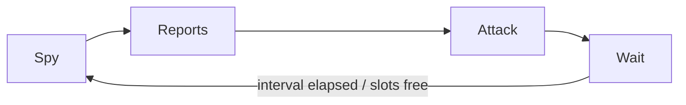

# Auto-attacks

The **Auto-attaques** tab runs a **campaign** over the active frigos: it probes them, reads the fresh spy reports, then raids the ones with no fleet and no defense, richest first, possibly in several waves. Campaigns repeat on an interval, or whenever enough fleet slots are free while the player is away.

- [Quick start](#quick-start)
- [Settings](#settings)
- [A cycle step by step](#a-cycle-step-by-step)
- [Triggers: interval or free slots](#triggers-interval-or-free-slots)
- [Waiting, retries and skipped targets](#waiting-retries-and-skipped-targets)
- [The Auto-attaques tab](#the-auto-attaques-tab)
- [Countdown](#countdown)
- [Safety rules](#safety-rules)
- [Stored data](#stored-data)
- [Code map](#code-map)

---

## Quick start

1. Add frigos (see [Frigos](frigos-and-reports.md)); only those **enabled and not ignored** are used.
2. In **Paramètres**, check « Planète mère pour les campagnes », the effective PT / GT capacities, « Butin minimum pour attaquer », the trigger mode and the reserved slots.
3. Make sure the home planet has probes and small or large cargo ships.
4. In **Auto-attaques**, click « Démarrer la campagne » and confirm.

Everything then runs in the background in a hidden frame; the visible page stays where it is. The browser must stay open.

---

## Settings

All in the **Paramètres** tab (see [Settings](settings-backups-diagnostic.md#paramètres)):

| Setting | Default | Role |
|---|---|---|
| Déclenchement des auto-attaques | Intervalle entre les cycles | « interval » or « Slots libres + joueur inactif ». |
| Intervalle entre les cycles d’auto-attaques (minutes) | 360 | Time between two cycles in interval mode (1 – 10,080). |
| Slots utilisables libres nécessaires (hors réserve) | 3 | Slots mode: free slots needed, after the reserve. |
| Inactivité avant lancement par slots (secondes) | 60 | Slots mode: player inactivity needed (≥ 15). |
| Planète mère pour les campagnes | first planet of the OGame list | Where probes and raids leave from (planets only). |
| Maximum de vagues par frigo et par cycle | 10 | Upper limit of raids on one frigo in one cycle. |
| Butin minimum pour attaquer | 10,000 | Frigos below this estimated loot are not raided. |
| Capacité effective PT / GT | 5,000 / 25,000 | Used to size the raids. |
| Attente maximale des slots / vaisseaux (minutes) | 10 | How long to wait for ships or slots before retrying. |
| Slots de flotte à garder libres pour les auto-attaques et sondages | 1 | Slots never used by the campaign (also respected by expeditions). |
| Pillage par défaut (%) | 50 | When a report does not state it. |
| Sondes par défaut | 1 | Probes for new frigos. |

Saving the settings during a campaign applies the new trigger mode and resumes the campaign.

---

## A cycle step by step

### 1. Spy (`phase: "spy"`)

For each active frigo, in list order:

1. Open the home planet’s fleet page towards the frigo (espionage mission) in the worker frame.
2. Check the destination shown by OGame matches the frigo, and that a fleet slot is free beyond the reserve.
3. Read the fleet movements: if **an attack is already on its way** to this frigo, the frigo is skipped for this cycle (no probe, no raid).
4. Check enough probes are available (`probeCount`); otherwise wait for their return.
5. Select the probes, check fuel, and send through OGame’s own dispatcher. The send time is recorded only once OGame confirms success.

### 2. Reports (`phase: "reports"`)

1. Open Messages › Espionnage in the worker frame.
2. Read the reports visible on the page and the report list through OGame’s message endpoint (`component=messages&action=getMessagesList`, subtab 20).
3. Keep a report only if it is for a frigo of this cycle, has OGame’s own timestamp, and is **not older than the probe send** of this cycle.
4. Missing reports: the page is reloaded every 30 s. After **30 minutes** without a new report, the missing frigos are dropped from this cycle (and recorded as failures); the cycle continues with the others.
5. All fresh reports are saved into the frigos.
6. **Attack list**: frigos whose report says fleet **0** and defense **0** explicitly, with loot ≥ « Butin minimum pour attaquer », sorted by loot, richest first. Others are marked « Butin sous le seuil · aucune attaque » or with the report warning.

### 3. Attack (`phase: "attack"`)

For each frigo of the attack list:

1. Open the home planet’s fleet page towards the frigo (attack mission).
2. **Size the raid** for the loot still expected: small cargos first (as many as needed and available), then large cargos for the rest. If the ships available cannot carry everything, the raid still leaves (« Transport partiel ») and the shortfall is shown.
3. If OGame asks for a manual confirmation (strong player warning, planet move in progress), the frigo is skipped: nothing is sent.
4. Check fuel and send.
5. **Waves**: after a raid, the resources left on the frigo are recomputed. If the remaining loot is still ≥ the minimum and the number of waves is below « Maximum de vagues par frigo et par cycle », the frigo goes back into the list. The list is re-sorted by remaining loot after each raid.
6. **Slots full**: if probes from this cycle are still flying back, the campaign waits (re-check every 30 s) — reports arrive at impact but probes keep their slot on the way back. Otherwise the cycle ends and the remaining frigos are deferred to the next cycle (« Limite de slots atteinte · … reportées au prochain cycle »).

### 4. Wait (`phase: "wait"`)

The next cycle starts after the interval, or in slots mode as soon as the conditions are met (see below). A new cycle starts again from Spy with the frigos active at that moment.

---

## Triggers: interval or free slots

**Intervalle entre les cycles**: the next cycle starts « Intervalle … (minutes) » after the end of the previous one.

In both modes, cycles are run by the tab that **owns** the campaign. After the browser has been closed (or in another tab), the panel shows « Suivre dans cet onglet »: click it to make the current tab the owner; a due cycle then starts.

**Slots libres + joueur inactif** (`monitorSlotCampaign`): while waiting, every 15 s, when the player has been inactive for « Inactivité avant lancement par slots », the script reads the home planet’s fleet page in a hidden frame (`sephi-slots-worker`). If the free slots minus the reserve reach « Slots utilisables libres nécessaires », it returns the visible page to the home planet if needed, then starts the cycle. Nothing starts while a discovery scan, an evacuation or a construction launch is in progress.

---

## Waiting, retries and skipped targets

| Situation | Behaviour |
|---|---|
| Not enough probes / transporters | Waits for returns: reloads the fleet page every 15 s. After « Attente maximale des slots / vaisseaux », switches to a retry. |
| Temporary failure (dispatcher not ready, fuel data missing, destination mismatch, OGame refusal…) | Retries **at the same point** after 15 s, 30 s, then 60 s. After 3 retries, the frigo is skipped for this cycle. |
| Destination invalid | The galaxy is read twice; if the planet or moon really no longer exists, the frigo is **deleted** from the list (« Frigo supprimé · planète ou lune inexistante confirmée »). |
| Fuel consumption unavailable | The frigo is dropped (`discardUnavailableFuelTarget`). |
| Navigation or reload during a send whose result is unknown | The frigo is skipped to **avoid a double send**; the uncertain send is kept for review. |
| Discovery scan running | The next cycle waits; a campaign cannot start during a scan. |
| Incoming attack with auto-éject | The current cycle is abandoned in favour of the evacuation. |

Every failure is recorded with time, frigo, phase and message, shown in « Échecs et reprises mémorisés » and next to the frigo in the Frigos tab.

---

## The Auto-attaques tab

- Explanation of the rules and, in slots mode, the current trigger conditions.
- **Before a campaign**: the number of active frigos, the table, « Démarrer la campagne » (asks for confirmation: probes then attacks will be sent automatically from the home planet).
- **During a campaign**: « État : En cours · Espionnage · 3/12 », the last message, the slots split observed (espionage / attacks in flight), and the table:

| Column | Content |
|---|---|
| Nom du frigo, Coordonnées | The frigo. |
| Butin | Loot of the fresh report. |
| Flotte, Défenses | From the fresh report (`?` if unknown). |
| Statut | « À venir », « Sondes envoyées », « Rapport lu · attaque à venir », « 12 PT + 3 GT envoyés », « 2 vagues envoyées · vague suivante estimée à … », « Reporté au prochain cycle », « Reprise 2/3 · … », a waiting message, or the report warning. |

Buttons:

- « Abandonner ce cycle » (owner tab, during a cycle): stops now; remaining frigos are deferred; the next cycle is scheduled.
- « Suivre dans cet onglet »: takes over a campaign run by another tab.
- « Nouvelle campagne »: clears the progress (asks for confirmation).

When a cycle ends, the panel closes itself if it was showing Auto-attaques in the main window.

---

## Countdown

« Temps restant avant la prochaine auto attaque : … » is shown in the panel header and as a bar at the top of the **overview** page:

- `hh:mm:ss` before the next cycle (interval mode);
- « attente des slots libres et de l’inactivité » (slots mode);
- « cycle en cours » during a cycle;
- « non programmée » without a campaign.

---

## Safety rules

- Only frigos with a fresh report stating **zero fleet and zero defense** are attacked.
- Frigos already targeted by an outbound attack are skipped.
- The destination shown by OGame must match the frigo before any selection.
- A send is counted only after OGame confirms it; an uncertain send is never repeated.
- OGame’s manual confirmation warnings are never bypassed: the frigo is skipped.
- Reserved fleet slots are kept free.
- The campaign runs in one tab only (its owner); construction rotation is suspended during a cycle.

---

## Stored data

| Key | Content |
|---|---|
| `<account>:auto-attack` | The campaign: `status`, `phase`, `targetIds`/`index`, `sentAt`, `reports`, `attackIds`/`attackIndex`, `attackDispatches`, `attackCounts`, `remainingResourceTotals`, `deferredIds`, `skippedTargets`, `waiting`, `retry`, `pending`, `nextRunAt`, `sourcePlanetId`, `runnerId`, `message`… |
| `<account>:failures` | Failure and retry history. |
| `<account>:slot-snapshot`, `<account>:slot-home` | Slots mode readings. |
| `<account>:auto-attack-continuation` (session) | Resumes the campaign after one of its own navigations. |
| `sephiogame:auto-log:<playerId>` (session) | Last 150 log entries, shown in Diagnostic. |

A campaign saved as paused or completed by an older version is turned into « waiting for the next cycle » when loaded.

---

## Code map

| Function | Role |
|---|---|
| `Panel.autoAttacks`, `campaignRows`, `campaignTable` | Tab and table. |
| `startAutoAttacks`, `beginNextAutoAttackRound`, `continueAutoAttacks` | Start, next cycle, main step dispatcher. |
| `dispatchAutoAttackFleet` | Probe / raid selection, checks and send through the native dispatcher. |
| `recordAutoAttackDispatchResult` | Confirmed send: next target, waves and re-sorting. |
| `collectAutoAttackReports`, `fetchFreshEspionageReports`, `inspectVisibleEspionageReports` | Fresh reports. |
| `waitForAutoAttackFleet`, `stopIfSlotsHaveNoEspionage`, `stopBlockedAutoAttackRound` | Waiting for ships or slots. |
| `scheduleCampaignRetry`, `runCampaignRetry`, `skipAutoAttackTarget`, `recoverUncertainDispatch` | Retries and skips. |
| `finishAutoAttackRound`, `abandonAutoAttackRound` | End of cycle. |
| `monitorSlotCampaign`, `runSlotWorker` | Slots mode. |
| `startCampaignWorker`, `handleAutoAttackNavigation` | Worker frame. |
| `plannedAttackLoot`, `campaignSlotsAvailable`, `nextAttackText` | Helpers. |
