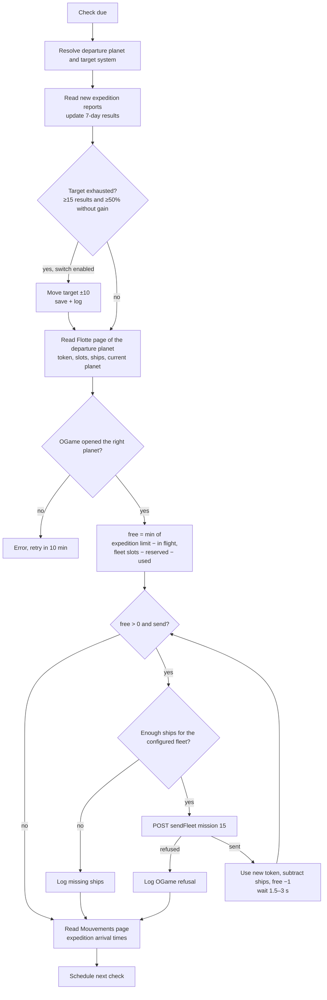

# Auto expeditions

The **Expéditions** tab of the SephiOGame panel sends expeditions with a fleet chosen by the player, and relaunches a new one each time an expedition comes back and frees a slot. It also reads the expedition reports to detect when the target system is exhausted, and moves the target to a neighbouring system.

Everything is done by calling OGame's own HTTP endpoints from the game page — no page is driven and no button is clicked.

- [Quick start](#quick-start)
- [The Expéditions tab](#the-expéditions-tab)
- [The automatic cycle](#the-automatic-cycle)
- [Scheduling: when checks happen](#scheduling-when-checks-happen)
- [Result tracking and exhausted systems](#result-tracking-and-exhausted-systems)
- [OGame requests used](#ogame-requests-used)
- [Stored data](#stored-data)
- [Safety rules and coordination](#safety-rules-and-coordination)
- [Limits and known behaviours](#limits-and-known-behaviours)
- [Troubleshooting](#troubleshooting)
- [Code map](#code-map)

---

## Quick start

1. Open the panel, tab **Expéditions**.
2. Choose the « Planète de départ » (planets and moons are listed).
3. Enter the number of each ship to send per expedition in « Flotte envoyée à chaque expédition ». « Disponible : N » under each field shows what the selected departure planet has (see [Available ships](#available-ships)).
4. Set « Automatique » to **Activée** and click **Enregistrer**. The first check runs a few seconds later.

To send immediately, once, without enabling the automatic mode: click **🚀 Envoyer maintenant**, then **⚠ Confirmer l’envoi** within 6 seconds.

> An OGame tab with the script must stay open in the browser for the automatic mode to run. See [Limits](#limits-and-known-behaviours).

---

## The Expéditions tab

### Settings

| Field | Values | Meaning |
|---|---|---|
| Automatique | Désactivée / Activée | Enables the automatic relaunch cycle. Off by default. Takes effect when « Enregistrer » is clicked. |
| Planète de départ | owned planets and moons | Where the fleet leaves from. The script checks that OGame really opened this planet before sending. |
| Système cible (galaxie:système) | e.g. `3:179`, or empty | System where the expeditions go (always position 16). Empty = the departure planet’s own system. Updated automatically when a system is exhausted. |
| Durée sur place | 1 h – 16 h | Expedition holding time. OGame rejects values above what the account’s research allows; the refusal is shown in the log. |
| Vitesse | 10 % – 100 % | Fleet speed. |
| Expéditions simultanées | « Maximum autorisé par OGame » or 1–12 | Upper limit of expeditions in flight. The OGame maximum (`maxExpeditionCount`) always applies as well. |
| Système épuisé | « Changer (±10) » / « Ne pas changer » | Enables the [exhausted-system switch](#result-tracking-and-exhausted-systems). On by default. |
| Flotte envoyée à chaque expédition | one number per ship type | Fleet sent by **each** expedition. At least one ship is required to save with « Automatique » on or to send. |

Ship types offered: Petit transporteur (202), Grand transporteur (203), Éclaireur (219), Chasseur léger (204), Chasseur lourd (205), Croiseur (206), Vaisseau de bataille (207), Traqueur (215), Bombardier (211), Destructeur (213), Faucheur (218), Recycleur (209), Sonde d’espionnage (210), Étoile de la mort (214).

The number of fleet slots kept free comes from the **Paramètres** tab (« Slots de flotte à garder libres pour les auto-attaques et sondages », setting `reservedFleetSlots`). Expeditions never use those slots.

### Available ships

Each ship field shows how many of that ship the **departure planet currently selected in the form** has — saved or not. Changing « Planète de départ » updates all the hints at once.

| Hint | Meaning |
|---|---|
| « Disponible : 3 442 » | Last reading for that planet. Hover to see when it was read. |
| « Disponible : inconnu · lecture en cours… » | No reading yet for that planet: its fleet page is being read in the background. |
| « Disponible : inconnu · lecture impossible » | The reading failed (hover for the reason); it is tried again after 1 minute. |
| « Disponible : choisissez une planète de départ » | No departure planet selected. |

- Readings are kept **per planet** (`shipsByPlanet`). They come from every cycle (« Actualiser l’état », automatic cycles, « Envoyer maintenant ») and from these background readings.
- A reading older than **15 minutes** is still shown, and refreshed in the background when the planet is displayed.
- Reading another planet’s fleet page makes it OGame’s active planet; after a background reading, the script switches OGame back to the planet on screen (light request to `component=eventList` with `cp=<current planet>`), so the next page opened in OGame is not affected.
- The hints refresh in place: what is being typed in the form is never lost.

### Buttons

| Button | Sends ships? | What it does |
|---|---|---|
| Enregistrer | No | Saves the form. If « Automatique » is **Activée**, schedules a check 3 seconds later. If **Désactivée**, cancels the scheduled check. |
| Actualiser l’état | **No** | Reads the expedition reports, the Flotte page (slots, ships available) and the Mouvements page (fleets in flight), then refreshes the panel. Never sends. |
| 🚀 Envoyer maintenant | Yes, after confirmation | First click arms the button (« ⚠ Confirmer l’envoi », orange, 6 s). Second click saves the values **currently on screen** and runs a sending cycle immediately — even with « Automatique » off. |

The confirmation is done inside the panel on purpose: native `confirm()` dialogs can be blocked or dismissed automatically by the browser or by automation tools.

### État des expéditions (status card)

- **Tiles**: Système cible, Automatique, Expéditions `x / X` (and the limit if lower), Flottes `y / Y · n réservé(s)`, Dernier contrôle, Prochain contrôle.
- **Message**: outcome of the last cycle, in red when it is an error.
- **Résultats sur 7 jours**: one row per system with known results — expeditions, without gain, rate, and OGame’s own depletion level. The current target is highlighted; the rate turns red once the switch threshold is reached.
- **En vol**: expedition fleets in flight and when they land next (« Arrivée » outbound, « Retour » inbound).
- **Journal**: the last 10 events (sends, refusals, reports analysed, system switches, errors), newest first.

The card refreshes by itself when a cycle runs, including a cycle run by another OGame tab.

---

## The automatic cycle

`runExpeditionCycle({ send })` performs one cycle. `send: true` for automatic and « Envoyer maintenant » cycles, `send: false` for « Actualiser l’état ».

Details:

1. **Target**: `config.target` if set, otherwise the departure planet’s galaxy and system. Position is always 16.
2. **Reports**: new expedition reports are read and merged into the stored results (see [Result tracking](#result-tracking-and-exhausted-systems)). A failure here is logged but does not block sending.
3. **Exhausted system**: if the rule triggers and « Système épuisé » is « Changer », the target is replaced, saved in the configuration and logged.
4. **Flotte page snapshot** (`fetchFleetSnapshot`): reads `token`, `fleetCount`, `maxFleetCount`, `expeditionCount`, `maxExpeditionCount`, `shipsOnPlanet` and `currentPlanet` from the departure planet’s fleet page. If `currentPlanet` does not match the chosen planet (coordinates and planet/moon type), the cycle stops with an error.
5. **Free slots**: `min(limit − expeditionCount, maxFleetCount − reserved − fleetCount)`, where `limit` is « Expéditions simultanées » (or the OGame maximum).
6. **Sending loop**: for each free slot, check that the planet still has enough of every configured ship, then send one expedition. OGame returns a new token after each request, used for the next one. The loop stops on the first refusal or shortage.
7. **Movements** (`fetchExpeditionMovements`): reads expedition fleets in flight to plan the next check.
8. **State**: counters, available ships of the departure planet (after the sends), fleets in flight, message and next check time are saved and displayed.

---

## Scheduling: when checks happen

The panel’s automation clock ticks every second and calls `monitorExpeditions()`. It only does real work when:

- « Automatique » is **Activée**, and
- the scheduled time (`nextCheckAt`) has passed, and
- no cycle is already running in this tab, and
- no other tab holds the expedition lease, and
- no auto-attack send or auto-éject evacuation is in progress (otherwise it retries in 1 minute).

After a sending cycle, the next check is computed by `nextExpeditionCheck()`:

| Situation | Next check |
|---|---|
| Expeditions in flight | **90 s after the next one lands** (clock margin with the server) |
| Nothing in flight | 30 min later |
| Always | never sooner than **2 min**, never later than **1 h** |
| After an error | 10 min later |

For an expedition still on its way out, the Mouvements page gives its arrival at position 16, not its return. The script then checks at that moment, finds nothing free, and reschedules for the return — one extra light check, no sending.

« Actualiser l’état » does not change the schedule.

---

## Result tracking and exhausted systems

### Where results come from

Expedition reports are in the messages, Flotte › Expéditions subtab (**subtab 22**). Each report contains a hidden `.rawMessageData` element with structured data:

| Attribute | Example | Used for |
|---|---|---|
| `data-raw-messagetype` | `41` | identifies an expedition result |
| `data-raw-timestamp` | `1795645592` | 7-day window |
| `data-raw-coords` | `3:414:16` | system the expedition went to |
| `data-raw-expeditionresult` | `ressources` | outcome type (stored, informative) |
| `data-raw-…gained` | `data-raw-resourcesgained='{"crystal":2630250}'` | what came back |
| `data-raw-depletion` | `1` | OGame’s depletion level of the system (shown in the table) |

### Gain or nothing

A result counts as a **gain** when at least one `data-raw-…gained` attribute holds a non-empty value (resources, ships, dark matter, items). Everything else counts as **nothing**: empty expedition, delay, early return, pirates or aliens, lost fleet, merchant.

This classification relies on the `…gained` fields rather than on the names of the outcomes, so new or unknown outcome names are handled the same way.

### Collection

`collectExpeditionResults()` runs at the start of every cycle (automatic, « Envoyer maintenant » and « Actualiser l’état »):

- reads the report list newest first, page by page (at most 10 pages per cycle);
- stops at the first page that contains nothing new, or once it reaches reports older than 7 days;
- stores each result by message id, so a report counts once, and stays counted even if the player deletes it in OGame;
- keeps only the last **7 days** (and at most 2,000 entries).

The 7-day window keeps the rate reactive: with all-time statistics, a system that used to be good would take far too long to drop under 50 %.

### Switch rule

`exhaustedSystemSwitch()` decides before sending:

- **Trigger**: the current target system has **at least 15 results** in the last 7 days **and at least 50 %** of them brought nothing.
- **Candidates**: the systems at **+10** and **−10** in the same galaxy, within `1 … systems of the universe` (read from `/api/serverData.xml`, cached 7 days, default 499).
- **Choice**: the candidate with the lowest rate of results without gain over the last 7 days. A system with no data counts as fresh (0 %). On a tie, +10 wins.
- **Effect**: the new system is saved as « Système cible » and the switch is logged, e.g. `Système 3:414 épuisé (9/16 sans gain sur 7 j) → passage en 3:424.` The new system starts with its own statistics, so it does not switch again before 15 results.

Only results of the target system count; results of other systems (for example expeditions sent manually from another planet) are kept in their own rows.

---

## OGame requests used

All requests are same-origin, use the player’s session cookies, and are sent with `X-Requested-With: XMLHttpRequest`.

| Purpose | Request | Data read or sent |
|---|---|---|
| Fleet page of the departure planet | `GET /game/index.php?page=ingame&component=fleetdispatch&cp=<planetId>` | Reads `var token`, `fleetCount`, `maxFleetCount`, `expeditionCount`, `maxExpeditionCount`, `shipsOnPlanet`, `currentPlanet`. `cp` switches the active planet, like any OGame link. |
| Send one expedition | `POST /game/index.php?page=ingame&component=fleetdispatch&action=sendFleet&asJson=1&cp=<planetId>` | `token`, `am<shipId>=<count>`, `galaxy`, `system`, `position=16`, `type=1`, `metal=0`, `crystal=0`, `deuterium=0`, `food=0`, `prioMetal=2`, `prioCrystal=3`, `prioDeuterium=4`, `prioFood=1`, `mission=15`, `speed=<1–10>`, `retreatAfterDefenderRetreat=0`, `lootFoodOnAttack=0`, `union=0`, `holdingtime=<hours>`. Response: `success`, `errors`, `newAjaxToken`. |
| Fleets in flight | `GET /game/index.php?page=ingame&component=movement` | `data-mission-type="15"`, `data-return-flight`, `data-arrival-time` (unix seconds). |
| Expedition reports | `POST /game/index.php?page=componentOnly&component=messages&asJson=1&action=getMessagesList` | `activeSubTab=22`, `showTrash=false`, `messagePage=<n>`. Response: `messages` (HTML fragments), `pageCount`. |
| Universe size | `GET /api/serverData.xml` | `<systems>`. |

The send request is the one the Flotte page itself makes when « Envoyer » is clicked (`FleetDispatcher.submitFleet2`). The lighter galaxy shortcut used by OGame’s expedition templates (`action=miniFleet`) is **not** used: OGame reserves it to accounts with the **Amiral** officer (« Il vous faut un amiral pour pouvoir utiliser cette fonction »).

---

## Stored data

All data is in the browser’s `localStorage` for the OGame domain. `<account>` = `sephiogame:v4:<universe>:<playerId>`.

| Key | Content |
|---|---|
| `<account>:expedition-config` | Settings of the tab: `enabled`, `planetId`, `target`, `holdingTime`, `speed`, `maxConcurrent`, `ships` (`{ shipId: count }`), `autoSwitch`. |
| `<account>:expedition-state` | Last cycle: `lastCheckAt`, `nextCheckAt`, `counts`, `shipsByPlanet` (per planet id: `at`, `available` ships), `movements`, `message`, `error`, `log` (15 entries). |
| `<account>:expedition-results` | Results of the last 7 days: `id` (message id), `at`, `system`, `result`, `gain`, `gained`, `depletion`. |
| `<account>:expedition-lease` | Which tab runs the current cycle (`owner`, `at`). Removed at the end of the cycle. |
| `sephiogame:<host>:systems` | Number of systems in the universe, cached 7 days. |

The expedition data is **not** included in the Sauvegardes JSON export.

---

## Safety rules and coordination

- **One tab at a time**: a lease in `localStorage` prevents two OGame tabs from running a cycle together. A lease older than 90 s is considered abandoned.
- **Main window only**: the cycle never runs inside the script’s hidden worker frames.
- **Other fleet actions first**: no cycle while an auto-attack dispatch is pending or an auto-éject evacuation is being prepared.
- **Reserved slots**: the « Slots de flotte à garder libres » setting is always respected.
- **Right planet**: sending is refused if the fleet page opened a different planet or moon than the one configured.
- **Ships check**: before each send, every configured ship must be available in the requested quantity; otherwise nothing is sent and the shortage is logged.
- **Stop on refusal**: the first refusal from OGame ends the sending loop for this cycle.
- **Pacing**: 1.5–3 s random pause between two sends in the same cycle.
- **Off by default**: nothing is sent until the player saves « Automatique : Activée » or confirms « Envoyer maintenant ».

---

## Limits and known behaviours

- **A tab must be open.** The script runs in the OGame page. With every OGame tab closed, nothing is relaunched; on reopening, a check runs at once if one was due.
- **Active planet changes during a cycle.** A cycle reads the departure planet’s fleet page with `cp=<planetId>`, which switches OGame’s active planet, as the construction rotation already does. The next page opened in OGame may show the departure planet. (Background readings of [available ships](#available-ships) switch back afterwards.)
- **Token of an open page.** If the Galaxy or Flotte page is open in another tab while a send happens, its token can become stale; that page then needs a reload.
- **Reports marked as read.** Reading the reports through the messages API may mark them as read in OGame.
- **Holding time.** The panel offers 1–16 h; the real maximum depends on the account’s research and OGame refuses higher values.
- **Unknown outcome names.** Only « ressources » has been observed so far; other outcomes are classified through the `…gained` fields (see [Gain or nothing](#gain-or-nothing)).

---

## Troubleshooting

| Symptom | Where to look | Likely cause |
|---|---|---|
| Nothing happens after enabling | « Prochain contrôle » tile and Journal | « Automatique » was changed but « Enregistrer » not clicked; or no OGame tab open. |
| « Toutes les expéditions autorisées sont en cours. » | Expéditions tile | All slots busy; the next check is after the next return. |
| « Pas de slot de flotte libre (réserve comprise). » | Flottes tile | Fleet slots used by other missions plus the reserve leave no room. |
| « Vaisseaux insuffisants sur … : il manque … » | Journal | Ships lost or used elsewhere; the next check retries. |
| « OGame a refusé l’expédition : … » | Journal | OGame’s message is quoted (holding time too long, not enough deuterium, etc.). |
| « OGame a ouvert … au lieu de … » | Message | The fleet page opened another planet; retried in 10 min. |
| « Rapports d’expédition non lus : … » | Journal | The messages API failed; sending still went ahead. |
| Target changed by itself | Journal, Résultats sur 7 jours | The exhausted-system switch triggered; set « Système épuisé » to « Ne pas changer » to keep a fixed target. |

The **Diagnostic** tab and the browser console (`[SephiOGame …]` lines) give more context when reporting a problem.

---

## Code map

All in [`sephi-ogame-reborn.user.js`](../sephi-ogame-reborn.user.js).

| Function | Role |
|---|---|
| `EXPEDITION_SHIPS`, `EXPEDITION_MISSION`, `EXPEDITION_POSITION` | Ship list and constants (mission 15, position 16). |
| `defaultExpeditionConfig()` | Default settings. |
| `gameURL(params)` | Builds `/game/index.php` URLs. |
| `fetchFleetSnapshot(planetId)` | Reads the departure planet’s fleet page. |
| `Panel.showExpeditionShips(planetId, hints)`, `Panel.readExpeditionShips(planetId)` | « Disponible » hints for the selected planet; background reading and switch back. |
| `EXPEDITION_SHIPS_MAX_AGE` | Age after which a reading is refreshed (15 min). |
| `sendExpeditionFleet(...)` | Sends one expedition through `sendFleet`. |
| `fetchExpeditionMovements()` | Reads expedition fleets in flight. |
| `nextExpeditionCheck(fleets)` | Computes the next check time. |
| `parseExpeditionReport(node)` | Turns one report into a result. |
| `fetchExpeditionReports(knownIds, since)` | Reads new reports, newest first. |
| `systemStats(results, galaxy, system)` | Count, without gain, rate and depletion of one system. |
| `universeSystemCount()` | Number of systems in the universe. |
| `Panel.expeditions()` | Renders the tab and handles the buttons. |
| `Panel.updateExpeditionStatus()` | Renders the status card. |
| `Panel.monitorExpeditions()` | Clock entry point: decides when a cycle runs. |
| `Panel.runExpeditionCycle({ send })` | One full cycle. |
| `Panel.collectExpeditionResults()` | Updates the 7-day results. |
| `Panel.exhaustedSystemSwitch(target, results)` | Exhausted-system decision. |
| `EXPEDITION_STATS_DAYS`, `EXPEDITION_SWITCH_MIN`, `EXPEDITION_SWITCH_RATIO`, `EXPEDITION_SWITCH_STEP` | Rule parameters: 7 days, 15 results, 50 %, ±10 systems. |
