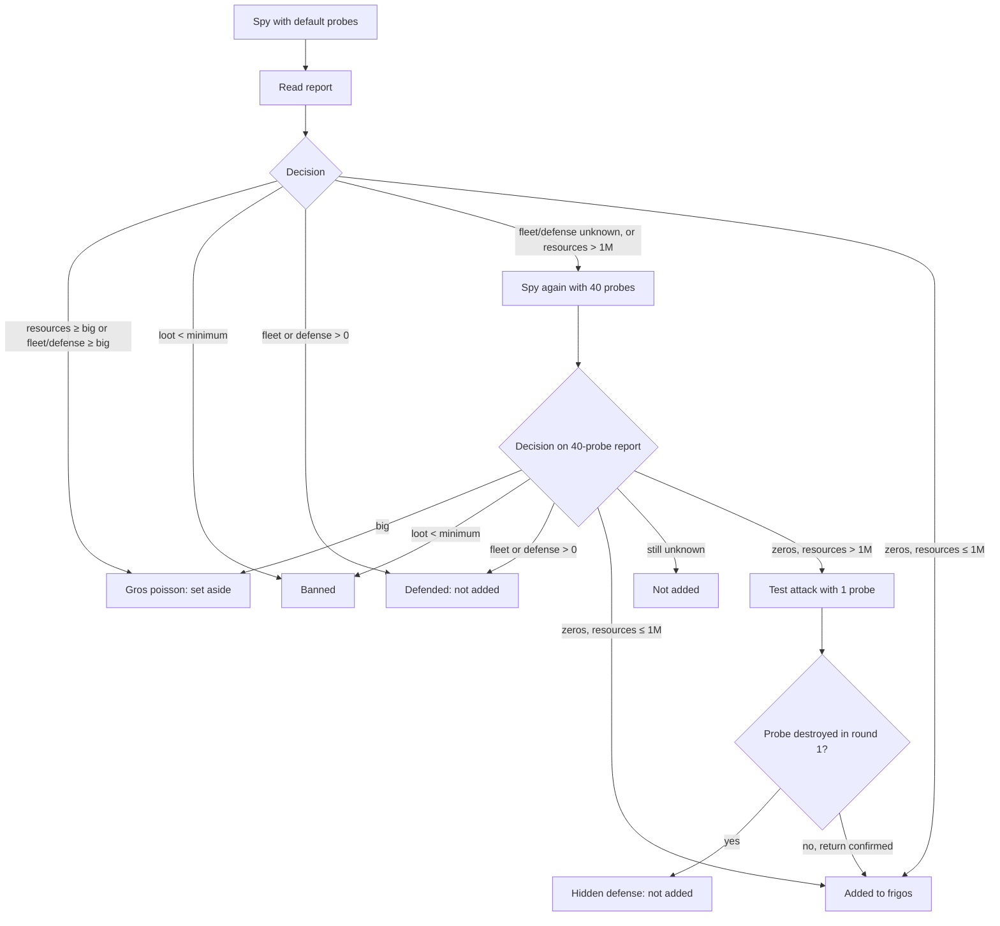

# Discovery

The **Découverte** tab scans the galaxy around the home planet for **inactive players**, probes them, and adds the safe and profitable ones to the frigos. Targets below the loot threshold are « banned » from future scans; very rich or well-defended ones are set aside as « gros poissons » for manual review.

A scan is always started manually.

- [Settings](#settings)
- [Which systems are scanned](#which-systems-are-scanned)
- [Which players are candidates](#which-players-are-candidates)
- [What happens to a candidate](#what-happens-to-a-candidate)
- [The Découverte tab](#the-découverte-tab)
- [Interaction with other features](#interaction-with-other-features)
- [Stored data](#stored-data)
- [Code map](#code-map)

---

## Settings

| Field | Default | Meaning |
|---|---|---|
| Étendue | Systèmes autour de la PM | Scan systems of the home planet’s galaxy, or whole galaxies. |
| Intervalle relatif à la PM | `0:10` | Which systems (or galaxies) relative to the home planet; see below. |
| Butin minimum pour conserver un frigo | 100,000 | Below this loot, the target is banned. |
| Gros poisson : ressources totales à partir de | 10,000,000 | From this total of resources, set aside as gros poisson (> 1,000,000). |
| Gros poisson : valeur flotte / défense à partir de | 5,000,000 | From this fleet or defense value (as in the report), set aside as gros poisson. |

The scan starts from the **home planet** set in Paramètres (« Planète mère pour les campagnes »); probes use « Sondes par défaut » and loot uses « Pillage par défaut ».

---

## Which systems are scanned

The interval is `a:b`, relative to the home planet’s system (or galaxy with « Galaxies entières »):

| Interval | Order visited |
|---|---|
| `0:10` | 0, −1, +1, −2, +2 … −10, +10 (closest first) |
| `10:20` | +10 … +20 |
| `-20:-10` | −10 … −20 |

Values outside the universe are ignored (no wrap-around). With « Galaxies entières », each galaxy of the interval is read entirely, systems closest to the home system first. The universe size comes from `/api/serverData.xml`.

Each system is read through OGame’s galaxy data (`component=galaxy&action=fetchGalaxyContent`, POST then GET), or by loading the galaxy page in a hidden frame if those are refused; the working method is remembered for the session.

---

## Which players are candidates

From each system, a row is a candidate only if:

- the player is marked **inactive** by OGame (`i` / `I`, explicit flag only — never guessed from names);
- the player is **not in vacation mode** and is not you;
- there is a real planet at that position.

Candidates already in the frigos, in the banned list (same player) or in the gros poissons (same player) are listed as ignored. A banned target is re-evaluated if the player at those coordinates has changed.

---

## What happens to a candidate

One candidate at a time, each step in the hidden worker frame:

Details:

- **Decision** (`discoveryDecision`), in this order: gros poisson → banned → defended → unknown (40 probes, then « not added ») → over 1,000,000 resources (40 probes, then test) → added.
- **Test attack**: only when the 40-probe report states fleet **and** defense are zero. One probe is sent on an attack mission; the script follows it in Mouvements, reads the combat report (a probe destroyed in the first round means hidden defense), and confirms its **return** on the fleet page before adding the target.
- **Added frigos** get the tags « découverte » (and « sonde revenue » after a test).
- **Time limits**: a report not received within 30 minutes, or a test probe not confirmed in time, ends the candidate (« Rapport ou retour non confirmé dans le délai · non ajouté »).
- **Errors**: each step is retried up to 3 times; a send whose result is unknown is never repeated — the scan pauses (« Envoi non confirmé · scan en pause… »).

---

## The Découverte tab

- The settings form and « Lancer ce scan » (disabled while a scan is running or paused).
- **Progress**: « Scan en cours · 12/21 systèmes · 8 résultat(s) », the departure planet, the current candidate and step (« envoi du sondage », « lecture du rapport à 40 sondes », « attaque de test à une sonde »…), retries, and the worker’s last event.
- « Dernier diagnostic du scan » and « Journal détaillé » (last 30 of 150 events kept).
- Buttons:
  - « Mettre en pause » (owner tab) — sends already made continue in OGame;
  - « Reprendre ici » (paused; refused while a send awaits confirmation or an auto-attack cycle runs);
  - « Poursuivre dans cet onglet » (take over from another tab);
  - « Écarter l’envoi incertain et reprendre » (after 45 s without confirmation — the candidate is not added and nothing is re-sent);
  - « Terminer le scan » (results kept);
  - « Exporter diagnostic du scan » and « Exporter ce rapport JSON ».
- **Results table**: Coordonnées, Butin trouvé, Flotte, Défense, Ajouté aux frigos, Gros poisson, Résultat (with a diagnostic when available).
- **Banned · n cible(s)**: one line per banned target with « Réautoriser ».
- **Gros poissons potentiels**: their table and « Réévaluer … au prochain scan ».
- **Rapports des scans précédents**: the last 5 scans.

---

## Interaction with other features

- A scan cannot start while an auto-attack cycle runs; a campaign cannot start (and the next cycle waits) while a scan runs.
- During a scan, the construction rotation and launches are suspended, and slots-mode monitoring stops.
- A scan step waits while an auto-éject evacuation is being prepared or confirmed.

---

## Stored data

| Key | Content |
|---|---|
| `<account>:discovery` | Current scan: status, owner tab, home planet, settings, zones, cursor, queue, result rows, worker, failures, journal. |
| `<account>:discovery-config` | Last settings used. |
| `<account>:discovery-reports` | Last 5 previous scans (rows and settings). |
| Main data `discoveryBanned`, `discoveryBigFish` | Banned targets and gros poissons; included in « Exporter JSON ». |

---

## Code map

| Function | Role |
|---|---|
| `Panel.discovery`, `discoveryTable` | Tab. |
| `startDiscovery`, `monitorDiscovery` | Start; step scheduling (reads systems, launches worker steps). |
| `applyDiscoveryResult`, `finishDiscoveryCandidate` | Worker results, decisions, adding / banning / setting aside. |
| `discoveryOffsets`, `discoverySystemAt` | Interval and visiting order. |
| `fetchGalaxySystem`, `fetchGalaxyViaNativeFrame` | Galaxy reading. |
| `discoveryCandidates`, `discoveryDecision` | Candidate filter and decision rule. |
| `runDiscoveryWorker`, `discoveryFlights`, `discoveryMovement`, `discoveryCombatMessages` | Worker frame steps. |
